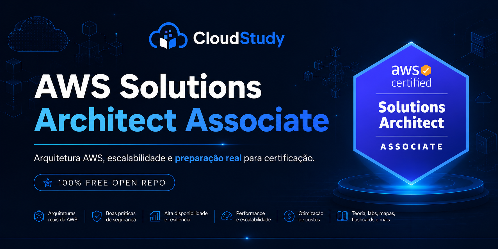
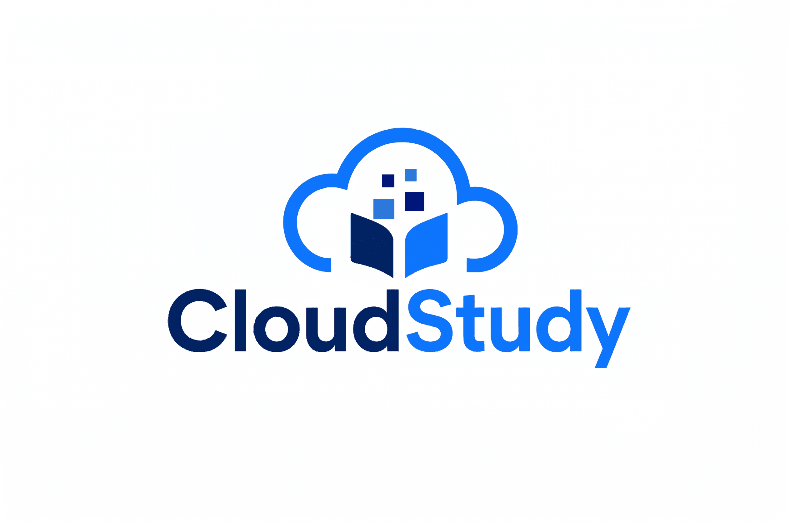

  

<em>AWS architecture, scalability, and practical certification preparation. Real-world AWS architectures; security best practices; high availability and resilience; performance and scalability; cost optimization; lessons, labs, study maps, flashcards, and more. 100% free open repository.</em>

  

  <strong> Prepare for AWS Certified Solutions Architect – Associate (SAA-C03) with lessons, labs, flashcards, cheatsheets, and practice exams.</strong>

  <strong> Join the CloudStudy waitlist and receive early access to the platform.</strong>

  

  
  &nbsp;&nbsp;
  

## Educational sponsorship

  This project has the support of
  <a href="https://www.cloudstudy.com.br">CloudStudy</a>.

  

 

<h1 align="center">AWS Certified Solutions Architect – Associate (SAA-C03)</h1>

  
  
  

  
  
  
  
  

  <a href="#how-to-use-this-repository">How to use</a> •
  <a href="#recommended-study-workflow">Study workflow</a> •
  <a href="#study-map">Study plan</a> •
  <a href="#modules">Modules</a> •
  <a href="./29-Practice-Exams-and-Questions/README.md">Practice exams</a> •
  <a href="#additional-aws-learning-paths">AWS learning paths</a>

Open educational resources by Thiago Cardoso • <a href="https://www.linkedin.com/in/analyticsthiagocardoso">LinkedIn</a>

---

## What you will find in this repository

| Topic | What you find here |
|---|---|
| Real-world AWS architectures | Exam scenarios, trade-offs and architectural decisions with a practical focus. |
| High availability and resilience | Multi-AZ, failover, decoupling, continuity and DR strategies. |
| Security and IAM | IAM, KMS, encryption, policies, auditing and applied governance. |
| Networking and VPC | Subnets, routing, endpoints, hybrid connectivity and network security. |
| Databases and storage | RDS, Aurora, DynamoDB, S3, EBS, EFS and choices by performance and cost. |
| Serverless and containers | Lambda, API Gateway, ECS, EKS, Fargate, and modern execution patterns. |
| Cost optimization | Rightsizing, storage classes, automation and cost-efficient decisions. |
| Practice exams with explanations | SAA-C03-style questions, answer-option reviews, and an error log. |
| Labs, study maps, and flashcards | Guided labs, weekly study plans, cheatsheets, and spaced review. |

## 🚦 Where to start

- **Beginner learning path (from scratch):** follow [Module 01](./01-Introducao-SAA-C03/README.md) → [Module 02](./02-IAM-e-Seguranca/README.md) → [Module 04](./04-Computacao-EC2/README.md) → [Module 05](./05-Alta-Disponibilidade-e-Escalabilidade/README.md) → [Module 06](./06-Amazon-S3-e-Armazenamento/README.md) → [Module 08](./08-VPC-e-Redes/README.md) → [Module 10](./10-Banco-de-Dados/README.md) and complete in order up to [Module 31](./31-Recursos-e-Links/README.md), including the corresponding labs in each week.
- **Quick review:** review [cheatsheets](./01-Introducao-SAA-C03/cheatsheet.md), [flashcards](./01-Introducao-SAA-C03/flashcards.md) and [questions](./29-Simulados-e-Questoes/README.md), prioritizing modules with greater weight in the exam (security, resilience, performance and cost).
- **Final review / last 14 days:** focus on [05](./05-Alta-Disponibilidade-e-Escalabilidade/README.md), [06](./06-Amazon-S3-e-Armazenamento/README.md), [08](./08-VPC-e-Redes/README.md), [10](./10-Banco-de-Dados/README.md), [13](./13-DNS-Route53-e-CloudFront/README.md), [14](./14-Desacoplamento-SQS-SNS-EventBridge/README.md), [17](./17-Serverless-Lambda-API-Gateway/README.md), [22](./22-Recuperacao-de-Desastres-e-Continuidade/README.md), [26](./26-Well-Architected-Framework/README.md) and finish with the [Module 29] hub(./29-Simulados-e-Questoes/README.md): mini practice exams, an error log, and a final review plan.

> An open English-language learning path for structured review of the AWS Certified Solutions Architect – Associate (SAA-C03) exam.

English branch: https://github.com/Thiago-code-lab/aws-certified-solutions-architect-associate-brasil/tree/saa-c03-english

## 🎯 About this Repository

This English edition provides open-source study material focused on architectural reasoning: trade-offs, use cases, exam pitfalls, labs selected for low-cost practice, and SAA-C03-style questions. The original Portuguese edition remains available on the `main` branch.

This material is designed for intermediate learners who already use AWS regularly and understand cloud fundamentals. It develops the reasoning expected of a solutions architect: evaluating trade-offs between resilience, performance, security, and cost, beyond memorizing facts.

This repository is designed for learning on GitHub. Across the curriculum, you will find lessons, exam-style questions, flashcards, cheatsheets, architectural scenarios, labs, and curated official links. The module sequence follows frequently tested exam topics and gradually increases in complexity for a 9-week review plan. Dedicated lab modules contain labs and links.

## 🖥️ Interactive Portal

The repository includes a single-file study portal (`aws-saa-portal.html`) that can be opened directly in the browser — no installation, no build.

**What it does:**

- Lists the 31 modules in a sidebar, with search and "All / Pending / Completed" filters.
- Loads the content of each module directly from this repository (via GitHub raw) and renders it as formatted Markdown.
- Tracks progress module by module — the checkmark and progress bar are saved in the browser (`localStorage`), without needing a login or backend.
- Shows progress by exam domain (resilience, performance, security, cost).
- Each module has a shortcut to open the corresponding `README.md`/`lab.md` directly on GitHub.

Open the [interactive study portal](./aws-saa-portal.html).

**How to use it:** download `aws-saa-portal.html` and open it in your browser, or preview this branch with a local HTTP server. Keep the existing Portuguese GitHub Pages deployment unchanged.

## 📊 Exam Structure and Domains

| Domain | Weight | Topics tested | Main modules |
|---|---:|---|---|
| Design Resilient Architectures | 30% | High availability, disaster recovery, decoupling, multi-AZ, and multi-Region | 05, 06, 08, 09, 13, 14, 21, 22, 24, 26 |
| Design High-Performing Architectures | 28% | Compute selection, caching, storage performance, networking, and databases | 04, 06, 08, 10, 11, 12, 13, 16, 18 |
| Design Secure Applications and Architectures | 24% | IAM, KMS, network isolation, encryption, audit trails, and governance | 02, 03, 08, 09, 14, 17, 20, 23, 24, 25 |
| Design Cost-Optimized Architectures | 18% | Rightsizing, storage classes, purchasing models, serverless, and automation | 04, 06, 15, 17, 21, 23 |

## 🗺️ Study Map

### Week 1

- Module 01: exam overview, strategy, domain weights, and frequently tested services
- Module 02: IAM, KMS, Organizations, Identity Center and policies
- Module 03: guided IAM and security lab

### Week 2

- Module 04: EC2, EBS, placement groups and purchasing models
- Module 05: ELB, ASG, health checks and scalability

### Week 3

- Module 06: S3, lifecycle, replication, classes and security
- Module 07: advanced S3 lab
- Module 08: VPC, subnets, endpoints, routes and network security
- Module 09: VPC and networking lab

### Week 4

- Module 10: databases for architecture (RDS, Aurora, DynamoDB, ElastiCache, Redshift)
- Module 11: RDS and relational databases lab
- Module 12: modeling and patterns with DynamoDB
- Module 13: Route 53, CloudFront, OAC, WAF and Global Accelerator

### Week 5

- Module 14: SQS, SNS, EventBridge and Step Functions
- Module 15: SQS/SNS messaging lab
- Module 16: ECS, EKS, Fargate, ECR and App Runner

### Week 6

- Module 17: Lambda, API Gateway, authorizers and serverless observability
- Module 18: Kinesis, Firehose, Glue, Athena, EMR and analytics

### Week 7

- Module 19: frequently tested managed AI and ML services
- Module 20: CloudWatch, CloudTrail, Config and X-Ray
- Module 21: DMS, MGN, DataSync, Snow Family and Transfer Family

### Week 8

- Module 22: disaster recovery, continuity, RTO/RPO and DR strategies
- Module 23: AWS Organizations, multi-account governance and cost optimization
- Module 24: advanced networking and hybrid connectivity (TGW, DX, VPN, PrivateLink)
- Module 25: encryption with KMS and secrets management with Secrets Manager/SSM

### Week 9

- Module 26: Well-Architected Framework and DR patterns
- Module 27: real-world case studies
- Module 28: end-to-end labs
- Module 29: practice exams and review
- Modules 30 and 31: glossary and official links review

## 📁 Modules

| # | Module | Predominant domain | Status | Link |
|---|---|---|---|---|
| 01 | Introduction to SAA-C03 | Foundations / Strategy | Open | [README](./01-Introducao-SAA-C03/README.md) |
| 02 | IAM and Security | Security | Open | [README](./02-IAM-e-Seguranca/README.md) |
| 03 | IAM and Security (Labs) | Security (hands-on) | Open | [Lab](./03-IAM-e-Seguranca-Labs/lab.md) |
| 04 | EC2 Compute | High performance | Open | [README](./04-Computacao-EC2/README.md) |
| 05 | High Availability and Scalability | Resilience | Open | [README](./05-Alta-Disponibilidade-e-Escalabilidade/README.md) |
| 06 | Amazon S3 and Storage | Resilience / Cost | Open | [README](./06-Amazon-S3-e-Armazenamento/README.md) |
| 07 | Advanced S3 (Labs) | Resilience (hands-on) | Open | [Lab](./07-S3-Avancado-Labs/lab.md) |
| 08 | VPC and Networking | Security / Resilience | Open | [README](./08-VPC-e-Redes/README.md) |
| 09 | VPC and Networking (Labs) | Security (hands-on) | Open | [Lab](./09-VPC-e-Redes-Labs/lab.md) |
| 10 | Databases | High performance | Open | [README](./10-Banco-de-Dados/README.md) |
| 11 | RDS and Relational Databases (Labs) | High performance (hands-on) | Open | [Lab](./11-RDS-e-Bancos-Relacionais-Labs/lab.md) |
| 12 | DynamoDB (Labs) | High performance (hands-on) | Open | [Lab](./12-DynamoDB/lab.md) |
| 13 | DNS, Route 53 and CloudFront | Resilience / Performance | Open | [README](./13-DNS-Route53-e-CloudFront/README.md) |
| 14 | Decoupling: SQS, SNS, EventBridge | Resilience | Open | [README](./14-Desacoplamento-SQS-SNS-EventBridge/README.md) |
| 15 | SQS and SNS (Labs) | Resilience (hands-on) | Open | [Lab](./15-SQS-SNS-Mensageria-Labs/lab.md) |
| 16 | Containers: ECS, EKS, Fargate | High performance | Open | [README](./16-Containers-ECS-EKS-Fargate/README.md) |
| 17 | Serverless: Lambda and API Gateway | Cost/Security | Open | [README](./17-Serverless-Lambda-API-Gateway/README.md) |
| 18 | Data and Analytics | High performance | Open | [README](./18-Dados-e-Analytics/README.md) |
| 19 | Machine Learning and AI | Managed Services | Open | [README](./19-Machine-Learning-e-IA/README.md) |
| 20 | Monitoring: CloudWatch and CloudTrail | Security / Operations | Open | [README](./20-Monitoramento-CloudWatch-CloudTrail/README.md) |
| 21 | Migration and Transfer | Resilience / Cost | Open | [README](./21-Migracao-e-Transferencia/README.md) |
| 22 | Disaster Recovery and Business Continuity | Resilience / Security | Open | [README](./22-Recuperacao-de-Desastres-e-Continuidade/README.md) |
| 23 | AWS Organizations, Governance and Costs | Security / Cost | Open | [README](./23-AWS-Organizations-Governanca-e-Custos/README.md) |
| 24 | Advanced Networking and Hybrid Connectivity | Security / Performance | Open | [README](./24-Redes-Avancadas-e-Conectividade-Hibrida/README.md) |
| 25 | Encryption, KMS, and Secrets Management | Security | Open | [README](./25-Criptografia-KMS-e-Gestao-de-Segredos/README.md) |
| 26 | Well-Architected Framework | All domains | Open | [README](./26-Well-Architected-Framework/README.md) |
| 27 | Real-World Use Cases | All domains | Open | [README](./27-Casos-de-Uso-Reais/README.md) |
| 28 | Hands-on Labs | Practice | Open | [README](./28-Labs-Praticos/README.md) |
| 29 | Practice Exams, Questions, and Final Review | All domains | Open | [README](./29-Simulados-e-Questoes/README.md) |
| 30 | Glossary | Review | Open | [README](./30-Glossario/README.md) |
| 31 | Resources and Links | Review | Open | [README](./31-Recursos-e-Links/README.md) |

## 🧩 Module Overview

| Module name | Week/position | Theory (Yes/No) | Lab (Yes/No) | Cheatsheet (Yes/No) | Practice questions (Yes/No) |
|---|---|---|---|---|---|
| [01 - Introduction to SAA-C03](./01-Introducao-SAA-C03/README.md) | Week 1 | Yes | Yes | Yes | Yes |
| [02 - IAM and Security](./02-IAM-e-Seguranca/README.md) | Week 1 | Yes | Yes | Yes | Yes |
| [03 - IAM and Security (Labs)](./03-IAM-e-Seguranca-Labs/lab.md) | Week 1 | No | Yes | No | No |
| [04 - EC2 Compute](./04-Computacao-EC2/README.md) | Week 2 | Yes | Yes | Yes | Yes |
| [05 - High Availability and Scalability](./05-Alta-Disponibilidade-e-Escalabilidade/README.md) | Week 2 | Yes | Yes | Yes | Yes |
| [06 - Amazon S3 and Storage](./06-Amazon-S3-e-Armazenamento/README.md) | Week 3 | Yes | No | Yes | Yes |
| [07 - Advanced S3 (Labs)](./07-S3-Avancado-Labs/lab.md) | Week 3 | No | Yes | No | No |
| [08 - VPC and Networking](./08-VPC-e-Redes/README.md) | Week 3 | Yes | No | Yes | Yes |
| [09 - VPC and Networking (Labs)](./09-VPC-e-Redes-Labs/lab.md) | Week 3 | No | Yes | No | No |
| [10 - Databases](./10-Banco-de-Dados/README.md) | Week 4 | Yes | No | Yes | Yes |
| [11 - RDS and Relational Databases (Labs)](./11-RDS-e-Bancos-Relacionais-Labs/lab.md) | Week 4 | No | Yes | No | No |
| [12 - DynamoDB (Labs)](./12-DynamoDB/lab.md) | Week 4 | No | Yes | No | No |
| [13 - DNS, Route 53 and CloudFront](./13-DNS-Route53-e-CloudFront/README.md) | Week 4 | Yes | No | Yes | Yes |
| [14 - Decoupling: SQS, SNS, EventBridge](./14-Desacoplamento-SQS-SNS-EventBridge/README.md) | Week 5 | Yes | No | Yes | Yes |
| [15 - SQS and SNS (Labs)](./15-SQS-SNS-Mensageria-Labs/lab.md) | Week 5 | No | Yes | No | No |
| [16 - Containers: ECS, EKS, Fargate](./16-Containers-ECS-EKS-Fargate/README.md) | Week 5 | Yes | No | Yes | Yes |
| [17 - Serverless: Lambda and API Gateway](./17-Serverless-Lambda-API-Gateway/README.md) | Week 6 | Yes | Yes | Yes | Yes |
| [18 - Data and Analytics](./18-Dados-e-Analytics/README.md) | Week 6 | Yes | Yes | Yes | Yes |
| [19 - Machine Learning and AI](./19-Machine-Learning-e-IA/README.md) | Week 7 | Yes | Yes | Yes | Yes |
| [20 - Monitoring: CloudWatch and CloudTrail](./20-Monitoramento-CloudWatch-CloudTrail/README.md) | Week 7 | Yes | Yes | Yes | Yes |
| [21 - Migration and Transfer](./21-Migracao-e-Transferencia/README.md) | Week 7 | Yes | Yes | Yes | Yes |
| [22 - Disaster Recovery and Business Continuity](./22-Recuperacao-de-Desastres-e-Continuidade/README.md) | Week 8 | Yes | Yes | Yes | Yes |
| [23 - AWS Organizations, Governance and Costs](./23-AWS-Organizations-Governanca-e-Custos/README.md) | Week 8 | Yes | Yes | Yes | Yes |
| [24 - Advanced Networking and Hybrid Connectivity](./24-Redes-Avancadas-e-Conectividade-Hibrida/README.md) | Week 8 | Yes | Yes | Yes | Yes |
| [25 - Encryption, KMS, and Secrets Management](./25-Criptografia-KMS-e-Gestao-de-Segredos/README.md) | Week 8 | Yes | Yes | Yes | Yes |
| [26 - Well-Architected Framework](./26-Well-Architected-Framework/README.md) | Week 9 | Yes | Yes | Yes | Yes |
| [27 - Real-World Use Cases](./27-Casos-de-Uso-Reais/README.md) | Week 9 | Yes | Yes | Yes | Yes |
| [28 - Hands-on Labs](./28-Labs-Praticos/README.md) | Week 9 | Yes | Yes | Yes | Yes |
| [29 - Practice Exams, Questions, and Final Review](./29-Simulados-e-Questoes/README.md) | Week 9 | Yes | Yes | Yes | Yes |
| [30 - Glossary](./30-Glossario/README.md) | Week 9 | Yes | Yes | Yes | Yes |
| [31 - Resources and Links](./31-Recursos-e-Links/README.md) | Week 9 | Yes | Yes | Yes | Yes |

## 🚀 How to Use This Repository

1. Start with module 01 to understand exam expectations, domain weights, and study strategy.
2. Study modules 02 to 25 in order and use the laboratory modules to consolidate critical topics.
3. At the end of each module, answer the questions before revealing the answer key.
4. Use flashcards for spaced review and the cheatsheet for a quick review before a practice exam.
5. Run the labs in us-east-1 whenever possible to maintain consistency with the material.
6. Finish your preparation with case studies, end-to-end labs, practice exams, an error log, and domain-based review.

## 🔁 Recommended Study Workflow

1. Read the module README to understand the context, services, and exam cues.
2. Review the cheatsheet before solving questions.
3. Solve the questions without opening the answer block.
4. Record recurring errors in the [error log](./29-Simulados-e-Questoes/caderno-de-erros.md).
5. Strengthen weak areas with flashcards and mini practice exams by domain.

## ✅ Short Final Review Checklist

- Differentiate Multi-AZ, Read Replica, backup, restore and DR strategies.
- Review IAM, KMS, Secrets Manager, policies and least privilege.
- Compare S3, EBS, EFS, FSx and storage classes.
- Practice VPC, endpoints, NAT Gateway, security groups, NACLs, and routing.
- Retry questions you answered incorrectly before starting new practice exams.

## 🧭 Additional AWS Learning Paths

- [AWS Certified Cloud Practitioner Brazil](https://github.com/Thiago-code-lab/aws-certified-cloud-practitioner-brasil): foundational material for learners who need to strengthen their cloud knowledge before SAA-C03.
- [AWS Certified AI Practitioner Brazil](https://github.com/Thiago-code-lab/aws-certified-ai-practitioner-brasil): an additional learning path connecting AWS architecture with generative AI services.
- [CloudStudy](https://www.cloudstudy.com.br/): additional support for guided study and continued learning, complementing this repository's open-source resources.

## ⚠️ Common Exam Pitfalls

| Common source of confusion | When to use each option | Typical exam pitfall |
|---|---|---|
| SNS vs SQS | SNS for pub/sub fanout; SQS for decoupled queue with asynchronous processing and consumption control. | Confusing broadcast to multiple consumers with point-to-point queue. |
| SQS Standard vs FIFO | Standard for high throughput when duplicates and occasional out-of-order delivery are acceptable; FIFO for strict ordering and deduplication. | Choosing FIFO unnecessarily and limiting scale, or choosing Standard when order is mandatory. |
| RDS Multi-AZ vs Read Replicas | Multi-AZ for high availability and failover; read replicas for read scaling and reporting. | Assuming Multi-AZ improves read performance or a read replica replaces synchronous HA. |
| NAT Gateway vs VPC Endpoint | NAT Gateway for general private egress to the internet; VPC Endpoint for private access to AWS services without internet. | Use NAT for S3/DynamoDB and pay more, even with an available endpoint. |
| ALB vs NLB vs CLB | ALB for HTTP/HTTPS layer 7; NLB for TCP/UDP/TLS layer 4 and low latency; CLB for legacy. | Ignore protocol requirement and sticky/session routing. |
| S3 Standard vs IA vs One Zone-IA vs Glacier | Standard for frequent access; IA for infrequent access; One Zone-IA for reproducible data; Glacier for archiving. | Choosing a cheap class without considering retrieval latency and minimum retention. |
| EBS vs EFS vs FSx | EBS for block storage on EC2; EFS for multi-AZ NFS file sharing on Linux; FSx for specialized file systems (Windows, Lustre, ONTAP, OpenZFS). | Treating EBS as shared storage for multiple instances without a specific architecture. |
| ASG vs scheduled scaling vs predictive scaling | ASG for automatic elasticity by metrics; scheduled for predictable events; predictive for historical patterns. | Only use scheduled under unpredictable load and lose resilience in peaks. |
| API Gateway vs ALB for Lambda | API Gateway for managed APIs with auth, throttling and versioning; ALB for simple HTTP routing with Lambda integration. | Choose ALB when the question asks for advanced API management features. |
| KMS CMK vs Secrets Manager vs SSM Parameter Store | KMS for encryption and keys; Secrets Manager for rotation and sensitive secrets; Parameter Store for parameters and simple secrets. | Assuming KMS alone manages the full secret lifecycle. |

## 🤝 How to contribute

See [CONTRIBUTING.md](./CONTRIBUTING.md) for guidance on opening issues, proposing labs and questions, and submitting focused pull requests to `saa-c03-english`.

Contributions are welcome, especially for:

- correct technical details and service limits
- improve question scenarios and explanations of answer options
- reflect recent changes to AWS services
- add clearer ASCII diagrams and more economical labs

When contributing, prefer small, technically justified changes with official AWS links when the subject involves specific service behavior.

## 📦 Releases

For content updates, see [GitHub Releases](https://github.com/Thiago-code-lab/aws-certified-solutions-architect-associate-brasil/releases) and the history at [CHANGELOG.md](./CHANGELOG.md).

## 📄 License

This repository is available under the [MIT License](./LICENSE).

English edition inventory, validation results, and known limitations: [release audit](./docs/english-edition/README.md).

## ✅ Content Quality and Last Review

- Content is based on official AWS documentation and relevant whitepapers.
- Examples and labs prioritize low-cost choices for practical study.
- The repository is updated periodically according to changes in AWS services and the exam blueprint.

**Last repository-wide review in the source edition:** April 8, 2026 (update this date after each comprehensive content review).

